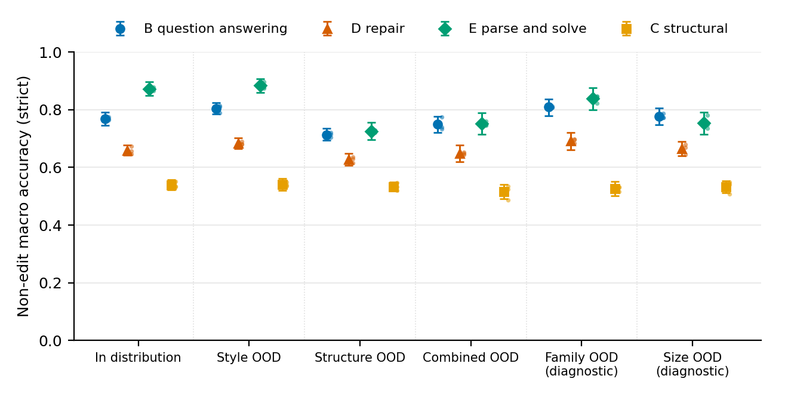

# Locked-test figure

Generated by `scripts/final_figures.py` (rule `final-figures-v1`) from `reports/final/final_table.json`; do not edit by hand.

Non-edit macro accuracy on the six locked splits, 12 runs. Marker = pooled over the three training seeds, bar = 95% interval over root graphs (2000 replicates), small dots = single seeds. All of these are copies of the final table. The last column is the pooled point minus the same arm's pooled point on `test_id`: the splits hold different root graphs, so it has no interval and is not a test of anything.

| Split | Roots | Arm | Pooled | 95% interval | Seeds | Minus test_id |
|---|---|---|---|---|---|---|
| test_id | 200 | B | 0.768 | [0.746, 0.791] | 2027: 0.764, 3407: 0.774, 9173: 0.768 | +0.000 |
| test_id | 200 | D | 0.659 | [0.642, 0.677] | 2027: 0.657, 3407: 0.646, 9173: 0.674 | +0.000 |
| test_id | 200 | E | 0.873 | [0.848, 0.896] | 2027: 0.866, 3407: 0.873, 9173: 0.879 | +0.000 |
| test_id | 200 | C | 0.540 | [0.522, 0.557] | 2027: 0.551, 3407: 0.535, 9173: 0.532 | +0.000 |
| test_style_ood | 200 | B | 0.804 | [0.785, 0.824] | 2027: 0.790, 3407: 0.814, 9173: 0.809 | +0.036 |
| test_style_ood | 200 | D | 0.683 | [0.665, 0.701] | 2027: 0.681, 3407: 0.680, 9173: 0.689 | +0.024 |
| test_style_ood | 200 | E | 0.883 | [0.859, 0.908] | 2027: 0.879, 3407: 0.897, 9173: 0.874 | +0.011 |
| test_style_ood | 200 | C | 0.541 | [0.521, 0.562] | 2027: 0.550, 3407: 0.539, 9173: 0.534 | +0.001 |
| test_struct_ood | 200 | B | 0.713 | [0.693, 0.735] | 2027: 0.715, 3407: 0.720, 9173: 0.704 | -0.055 |
| test_struct_ood | 200 | D | 0.627 | [0.607, 0.648] | 2027: 0.616, 3407: 0.635, 9173: 0.630 | -0.032 |
| test_struct_ood | 200 | E | 0.725 | [0.697, 0.756] | 2027: 0.726, 3407: 0.720, 9173: 0.730 | -0.147 |
| test_struct_ood | 200 | C | 0.533 | [0.517, 0.550] | 2027: 0.532, 3407: 0.520, 9173: 0.546 | -0.007 |
| test_combined_ood | 100 | B | 0.749 | [0.721, 0.777] | 2027: 0.775, 3407: 0.740, 9173: 0.732 | -0.019 |
| test_combined_ood | 100 | D | 0.648 | [0.620, 0.677] | 2027: 0.645, 3407: 0.653, 9173: 0.647 | -0.011 |
| test_combined_ood | 100 | E | 0.751 | [0.714, 0.789] | 2027: 0.748, 3407: 0.745, 9173: 0.760 | -0.122 |
| test_combined_ood | 100 | C | 0.516 | [0.491, 0.541] | 2027: 0.535, 3407: 0.487, 9173: 0.525 | -0.024 |
| test_family_ood | 100 | B | 0.809 | [0.779, 0.838] | 2027: 0.807, 3407: 0.812, 9173: 0.808 | +0.041 |
| test_family_ood | 100 | D | 0.692 | [0.662, 0.720] | 2027: 0.698, 3407: 0.682, 9173: 0.695 | +0.033 |
| test_family_ood | 100 | E | 0.838 | [0.800, 0.876] | 2027: 0.823, 3407: 0.847, 9173: 0.845 | -0.034 |
| test_family_ood | 100 | C | 0.526 | [0.501, 0.552] | 2027: 0.530, 3407: 0.515, 9173: 0.532 | -0.014 |
| test_size_ood | 100 | B | 0.777 | [0.748, 0.806] | 2027: 0.772, 3407: 0.787, 9173: 0.772 | +0.009 |
| test_size_ood | 100 | D | 0.665 | [0.641, 0.689] | 2027: 0.670, 3407: 0.645, 9173: 0.680 | +0.006 |
| test_size_ood | 100 | E | 0.754 | [0.714, 0.791] | 2027: 0.780, 3407: 0.748, 9173: 0.735 | -0.118 |
| test_size_ood | 100 | C | 0.533 | [0.513, 0.553] | 2027: 0.540, 3407: 0.508, 9173: 0.550 | -0.007 |
