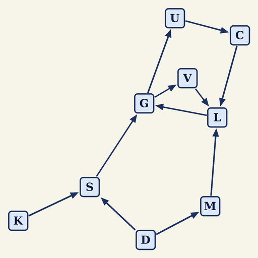
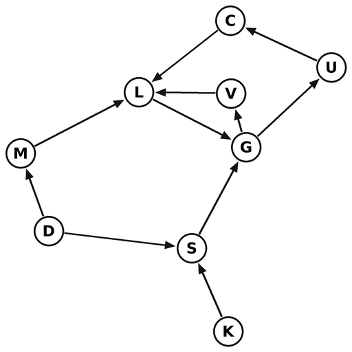
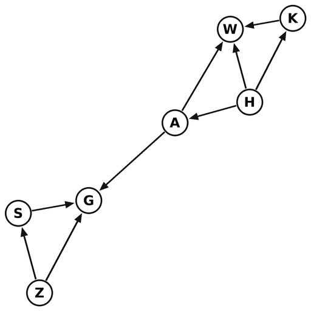
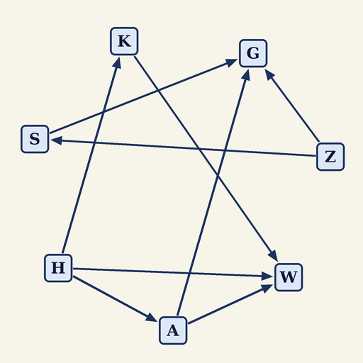
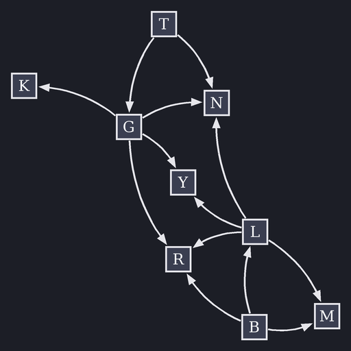
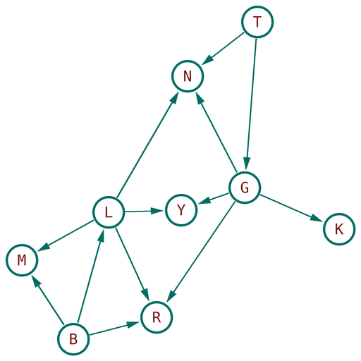
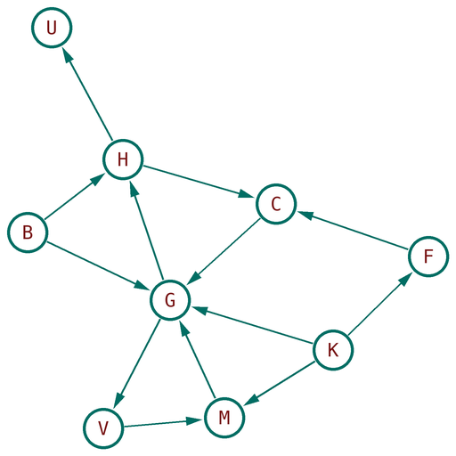
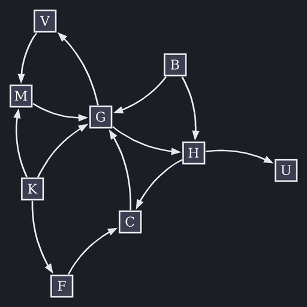

# Locked test: style-pair cards

Generated by `scripts/final_style_cards.py`; do not edit. One question asked on a root image and on a copy of the
same graph drawn in another style (same answer by construction). Rule `style-cards-v1`: pairs in a hash order that uses no
response or score; per split the first reachability and the first critical-edge pair. Every response is a recorded
line of a final kernel's predictions file whose sha256 matches the collected flags; the verdict is the verifier's.
An illustration, not a measurement: the invariance rates are in the invariance table.

## test_id (98 style pairs in the pool)

### Reachability

| Root image (style `b`) | Restyled copy (style `a`) |
|---|---|
|  |  |

Samples `sd362f0fab7f3f9c6` (root) and `sa13cec21cf393450` (copy).

```
Look at the directed graph in the image. Arrows show edge directions.
Following the arrow directions along one or more edges, is there a path from node G to node C?
Answer {"answer": true} or {"answer": false}. Answer with a single JSON object and nothing else.
```

True answer (from the generator's graph): `{"answer":true}`

| Arm | Seed | Root response | Verifier | Copy response | Verifier | Same correctness |
|---|---|---|---|---|---|---|
| B | 2027 | `{"answer":true}` | correct | `{"answer":true}` | correct | yes |
| B | 3407 | `{"answer":true}` | correct | `{"answer":true}` | correct | yes |
| B | 9173 | `{"answer":true}` | correct | `{"answer":true}` | correct | yes |
| D | 2027 | `{"answer": true}` | correct | `{"answer": true}` | correct | yes |
| D | 3407 | `{"answer": true}` | correct | `{"answer": true}` | correct | yes |
| D | 9173 | `{"answer": true}` | correct | `{"answer": true}` | correct | yes |
| E | 2027 | `{"answer":true}` | correct | `{"answer":true}` | correct | yes |
| E | 3407 | `{"answer":true}` | correct | `{"answer":true}` | correct | yes |
| E | 9173 | `{"answer":true}` | correct | `{"answer":true}` | correct | yes |
| C | 2027 | `{"answer":false}` | wrong (answer differs from the true graph's) | `{"answer":true}` | correct | no |
| C | 3407 | `{"answer":false}` | wrong (answer differs from the true graph's) | `{"answer":true}` | correct | no |
| C | 9173 | `{"answer":false}` | wrong (answer differs from the true graph's) | `{"answer":true}` | correct | no |

### Critical edge

| Root image (style `a`) | Restyled copy (style `b`) |
|---|---|
|  |  |

Samples `s644c79445d0edd94` (root) and `sc23df6fe21567585` (copy).

```
Look at the directed graph in the image. Arrows show edge directions.
Node H can currently reach node G by following arrows. If the edge H->A were removed, would H no longer be able to reach G?
Answer {"answer": true} if the connection would be lost, or {"answer": false} if H could still reach G. Answer with a single JSON object and nothing else.
```

True answer (from the generator's graph): `{"answer":true}`

| Arm | Seed | Root response | Verifier | Copy response | Verifier | Same correctness |
|---|---|---|---|---|---|---|
| B | 2027 | `{"answer":false}` | wrong (answer differs from the true graph's) | `{"answer":false}` | wrong (answer differs from the true graph's) | yes |
| B | 3407 | `{"answer":true}` | correct | `{"answer":false}` | wrong (answer differs from the true graph's) | no |
| B | 9173 | `{"answer":true}` | correct | `{"answer":false}` | wrong (answer differs from the true graph's) | no |
| D | 2027 | `{"answer": true}` | correct | `{"answer": true}` | correct | yes |
| D | 3407 | `{"answer": true}` | correct | `{"answer": true}` | correct | yes |
| D | 9173 | `{"answer": true}` | correct | `{"answer": true}` | correct | yes |
| E | 2027 | `{"answer":true}` | correct | `{"answer":true}` | correct | yes |
| E | 3407 | `{"answer":true}` | correct | `{"answer":false}` | wrong (answer differs from the true graph's) | no |
| E | 9173 | `{"answer":true}` | correct | `{"answer":true}` | correct | yes |
| C | 2027 | `{"answer":false}` | wrong (answer differs from the true graph's) | `{"answer":false}` | wrong (answer differs from the true graph's) | yes |
| C | 3407 | `{"answer":false}` | wrong (answer differs from the true graph's) | `{"answer":true}` | correct | no |
| C | 9173 | `{"answer":false}` | wrong (answer differs from the true graph's) | `{"answer":false}` | wrong (answer differs from the true graph's) | yes |

## test_style_ood (106 style pairs in the pool)

### Reachability

| Root image (style `x`) | Restyled copy (style `y`) |
|---|---|
|  |  |

Samples `s524ad271681af5e7` (root) and `s2c4e2135d4a7801c` (copy).

```
Look at the directed graph in the image. Arrows show edge directions.
Following the arrow directions along one or more edges, is there a path from node B to node L?
Answer {"answer": true} or {"answer": false}. Answer with a single JSON object and nothing else.
```

True answer (from the generator's graph): `{"answer":true}`

| Arm | Seed | Root response | Verifier | Copy response | Verifier | Same correctness |
|---|---|---|---|---|---|---|
| B | 2027 | `{"answer":true}` | correct | `{"answer":true}` | correct | yes |
| B | 3407 | `{"answer":true}` | correct | `{"answer":true}` | correct | yes |
| B | 9173 | `{"answer":true}` | correct | `{"answer":true}` | correct | yes |
| D | 2027 | `{"answer": true}` | correct | `{"answer": true}` | correct | yes |
| D | 3407 | `{"answer": true}` | correct | `{"answer": true}` | correct | yes |
| D | 9173 | `{"answer": true}` | correct | `{"answer": true}` | correct | yes |
| E | 2027 | `{"answer":true}` | correct | `{"answer":true}` | correct | yes |
| E | 3407 | `{"answer":true}` | correct | `{"answer":true}` | correct | yes |
| E | 9173 | `{"answer":true}` | correct | `{"answer":true}` | correct | yes |
| C | 2027 | `{"answer":false}` | wrong (answer differs from the true graph's) | `{"answer":true}` | correct | no |
| C | 3407 | `{"answer":true}` | correct | `{"answer":true}` | correct | yes |
| C | 9173 | `{"answer":true}` | correct | `{"answer":true}` | correct | yes |

### Critical edge

| Root image (style `y`) | Restyled copy (style `x`) |
|---|---|
|  |  |

Samples `s5902782afab60d55` (root) and `sb3c36b44421a5303` (copy).

```
Look at the directed graph in the image. Arrows show edge directions.
Node K can currently reach node M by following arrows. If the edge G->V were removed, would K no longer be able to reach M?
Answer {"answer": true} if the connection would be lost, or {"answer": false} if K could still reach M. Answer with a single JSON object and nothing else.
```

True answer (from the generator's graph): `{"answer":false}`

| Arm | Seed | Root response | Verifier | Copy response | Verifier | Same correctness |
|---|---|---|---|---|---|---|
| B | 2027 | `{"answer":false}` | correct | `{"answer":false}` | correct | yes |
| B | 3407 | `{"answer":false}` | correct | `{"answer":false}` | correct | yes |
| B | 9173 | `{"answer":false}` | correct | `{"answer":false}` | correct | yes |
| D | 2027 | `{"answer": false}` | correct | `{"answer": false}` | correct | yes |
| D | 3407 | `{"answer": false}` | correct | `{"answer": false}` | correct | yes |
| D | 9173 | `{"answer": false}` | correct | `{"answer": false}` | correct | yes |
| E | 2027 | `{"answer":false}` | correct | `{"answer":false}` | correct | yes |
| E | 3407 | `{"answer":false}` | correct | `{"answer":false}` | correct | yes |
| E | 9173 | `{"answer":false}` | correct | `{"answer":false}` | correct | yes |
| C | 2027 | `{"answer":false}` | correct | `{"answer":false}` | correct | yes |
| C | 3407 | `{"answer":false}` | correct | `{"answer":true}` | wrong (answer differs from the true graph's) | no |
| C | 9173 | `{"answer":true}` | wrong (answer differs from the true graph's) | `{"answer":true}` | wrong (answer differs from the true graph's) | yes |
