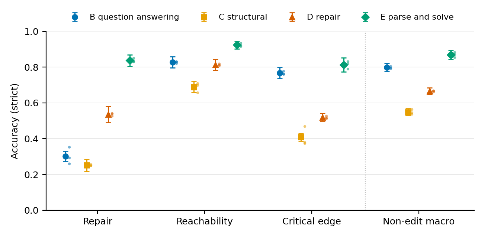
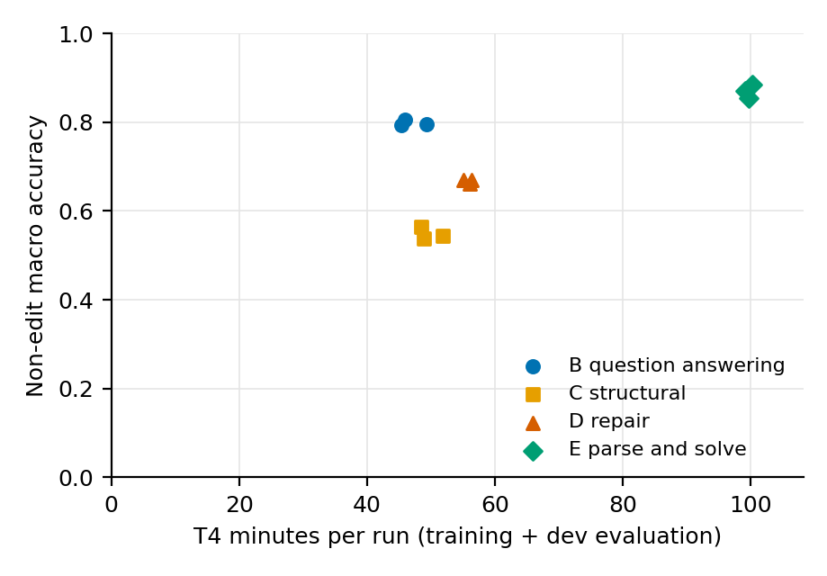
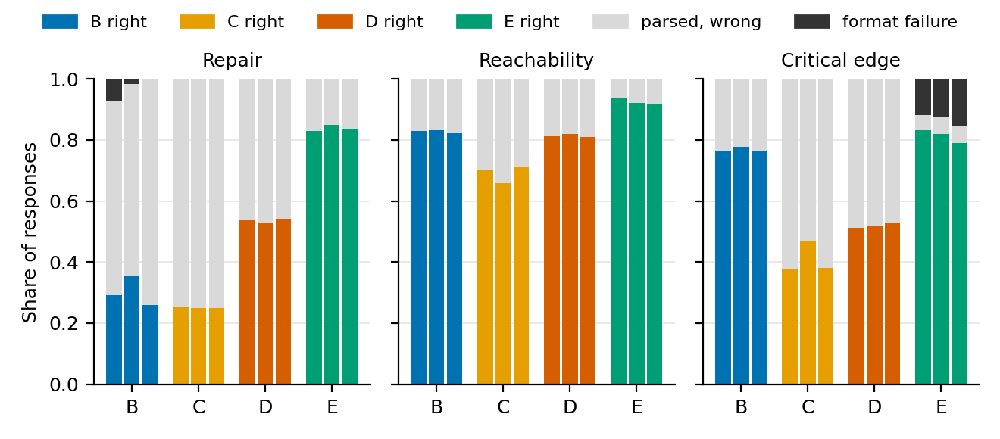

# Development-split figures

Generated by `scripts/dev_figures.py` from `reports/pilot/seeds_dev_interim.json` (rule `dev-figures-v2`). Development split, 200 root graphs; no locked-test value is used. Plotted values and source hashes: `figures_dev.json`.

## Arm comparison

Marker = accuracy pooled over the training seeds, bar = its 95% root-graph bootstrap interval, small dots = single seeds. The y axis runs from 0 to 1. The frozen base (arm A) is not drawn: it was evaluated on 20 of the dev roots only (`reports/pilot/base_prompt.md`).

## Cost against accuracy

One point per run. x = measured training seconds + dev evaluation seconds on a Kaggle T4 (kernel setup and data generation not counted), y = that run's non-edit macro accuracy. Arm E's seconds are its parser's training plus the transcribe-and-solve evaluation.

| Arm | Seed | Train s | Dev eval s | Total min | Non-edit macro |
|---|---|---|---|---|---|
| B | 3407 | 1638.8 | 1319.5 | 49.3 | 0.796 |
| B | 2027 | 1560.2 | 1200.1 | 46.0 | 0.805 |
| B | 9173 | 1487.7 | 1233.7 | 45.4 | 0.792 |
| C | 3407 | 1780.2 | 1158.5 | 49.0 | 0.537 |
| C | 2027 | 1784.8 | 1128.6 | 48.6 | 0.564 |
| C | 9173 | 1848.8 | 1263.1 | 51.9 | 0.545 |
| D | 3407 | 2062.7 | 1304.5 | 56.1 | 0.662 |
| D | 2027 | 2003.9 | 1300.2 | 55.1 | 0.669 |
| D | 9173 | 2079.3 | 1305.2 | 56.4 | 0.669 |
| E | 3407 | 1807.6 | 4211.1 | 100.3 | 0.884 |
| E | 2027 | 1807.2 | 4141.7 | 99.1 | 0.871 |
| E | 9173 | 1700.8 | 4287.8 | 99.8 | 0.854 |

## Error types

One bar per run (three training seeds per arm, in the order of the table below). Coloured = strict accuracy, light grey = the response parsed but was wrong, dark = format failure (strict parser; counts as wrong). Accuracy and format-failure rate are copied from each run's `summary.json`; the grey share is their remainder. For arm E a dark segment on the critical-edge task is a question whose premise failed on the transcribed graph, so the solver gave no answer; the count is in the last column.

| Arm | Seed | Task | n | Right | Parsed, wrong | Format failure | E: premise failed |
|---|---|---|---|---|---|---|---|
| B | 3407 | Repair | 400 | 0.2925 | 0.6350 | 0.0725 |  |
| B | 3407 | Reachability | 400 | 0.8300 | 0.1700 | 0.0000 |  |
| B | 3407 | Critical edge | 400 | 0.7625 | 0.2375 | 0.0000 |  |
| B | 2027 | Repair | 400 | 0.3525 | 0.6300 | 0.0175 |  |
| B | 2027 | Reachability | 400 | 0.8325 | 0.1675 | 0.0000 |  |
| B | 2027 | Critical edge | 400 | 0.7775 | 0.2225 | 0.0000 |  |
| B | 9173 | Repair | 400 | 0.2600 | 0.7375 | 0.0025 |  |
| B | 9173 | Reachability | 400 | 0.8225 | 0.1775 | 0.0000 |  |
| B | 9173 | Critical edge | 400 | 0.7625 | 0.2375 | 0.0000 |  |
| C | 3407 | Repair | 400 | 0.2550 | 0.7450 | 0.0000 |  |
| C | 3407 | Reachability | 400 | 0.7000 | 0.3000 | 0.0000 |  |
| C | 3407 | Critical edge | 400 | 0.3750 | 0.6250 | 0.0000 |  |
| C | 2027 | Repair | 400 | 0.2500 | 0.7500 | 0.0000 |  |
| C | 2027 | Reachability | 400 | 0.6575 | 0.3425 | 0.0000 |  |
| C | 2027 | Critical edge | 400 | 0.4700 | 0.5300 | 0.0000 |  |
| C | 9173 | Repair | 400 | 0.2500 | 0.7500 | 0.0000 |  |
| C | 9173 | Reachability | 400 | 0.7100 | 0.2900 | 0.0000 |  |
| C | 9173 | Critical edge | 400 | 0.3800 | 0.6200 | 0.0000 |  |
| D | 3407 | Repair | 400 | 0.5400 | 0.4600 | 0.0000 |  |
| D | 3407 | Reachability | 400 | 0.8125 | 0.1875 | 0.0000 |  |
| D | 3407 | Critical edge | 400 | 0.5125 | 0.4875 | 0.0000 |  |
| D | 2027 | Repair | 400 | 0.5275 | 0.4725 | 0.0000 |  |
| D | 2027 | Reachability | 400 | 0.8200 | 0.1800 | 0.0000 |  |
| D | 2027 | Critical edge | 400 | 0.5175 | 0.4825 | 0.0000 |  |
| D | 9173 | Repair | 400 | 0.5425 | 0.4575 | 0.0000 |  |
| D | 9173 | Reachability | 400 | 0.8100 | 0.1900 | 0.0000 |  |
| D | 9173 | Critical edge | 400 | 0.5275 | 0.4725 | 0.0000 |  |
| E | 3407 | Repair | 400 | 0.8300 | 0.1700 | 0.0000 |  |
| E | 3407 | Reachability | 400 | 0.9350 | 0.0650 | 0.0000 |  |
| E | 3407 | Critical edge | 400 | 0.8325 | 0.0500 | 0.1175 | 47 |
| E | 2027 | Repair | 400 | 0.8500 | 0.1500 | 0.0000 |  |
| E | 2027 | Reachability | 400 | 0.9225 | 0.0775 | 0.0000 |  |
| E | 2027 | Critical edge | 400 | 0.8200 | 0.0550 | 0.1250 | 50 |
| E | 9173 | Repair | 400 | 0.8350 | 0.1650 | 0.0000 |  |
| E | 9173 | Reachability | 400 | 0.9175 | 0.0825 | 0.0000 |  |
| E | 9173 | Critical edge | 400 | 0.7900 | 0.0550 | 0.1550 | 62 |

Repair detail (copied from the summaries). Status = the response's `status` field equals the solver's, over all repair samples; valid edit and minimal repair are over the samples whose reference answer changes the graph.

| Arm | Seed | Status right | Valid edit | Minimal repair | Samples needing an edit | Responses parsed |
|---|---|---|---|---|---|---|
| B | 3407 | 0.3500 | 0.0400 | 0.0400 | 200 | 371 of 400 |
| B | 2027 | 0.3825 | 0.0200 | 0.0200 | 200 | 393 of 400 |
| B | 9173 | 0.3700 | 0.0350 | 0.0350 | 200 | 399 of 400 |
| C | 3407 | 0.2750 | 0.0250 | 0.0250 | 200 | 400 of 400 |
| C | 2027 | 0.2525 | 0.0000 | 0.0000 | 200 | 400 of 400 |
| C | 9173 | 0.2725 | 0.0200 | 0.0200 | 200 | 400 of 400 |
| D | 3407 | 0.6175 | 0.3950 | 0.3950 | 200 | 400 of 400 |
| D | 2027 | 0.6100 | 0.3950 | 0.3950 | 200 | 400 of 400 |
| D | 9173 | 0.6400 | 0.3900 | 0.3900 | 200 | 400 of 400 |
| E | 3407 | 0.8525 | 0.7750 | 0.7750 | 200 | 400 of 400 |
| E | 2027 | 0.8700 | 0.8200 | 0.8200 | 200 | 400 of 400 |
| E | 9173 | 0.8500 | 0.7950 | 0.7950 | 200 | 400 of 400 |
