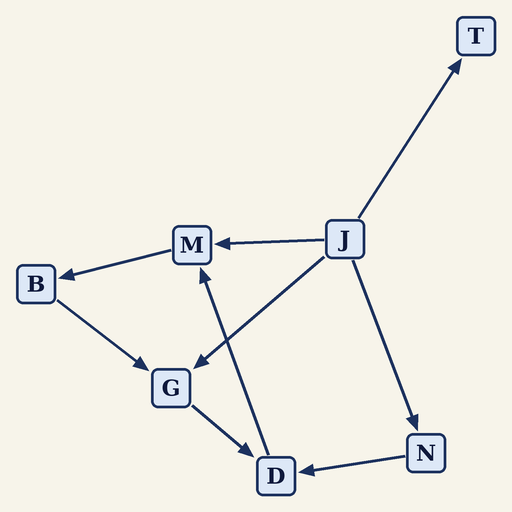
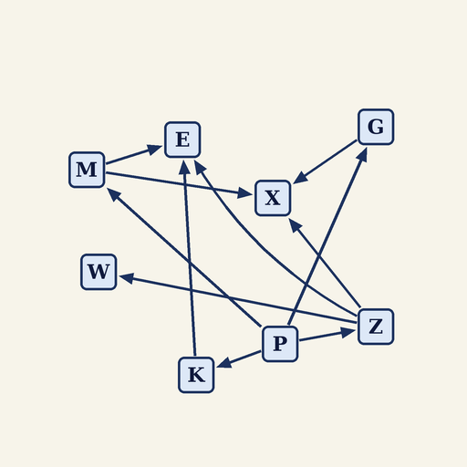
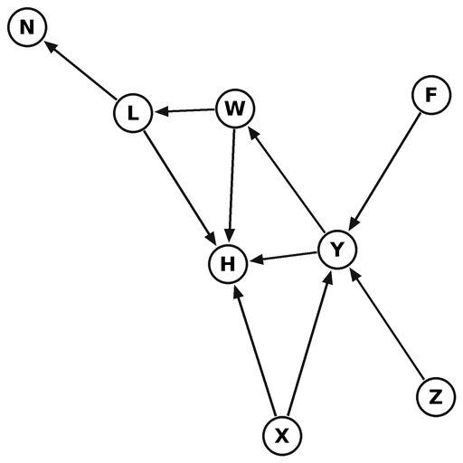
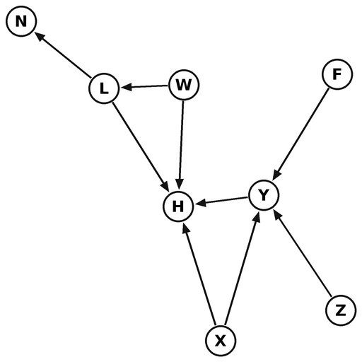
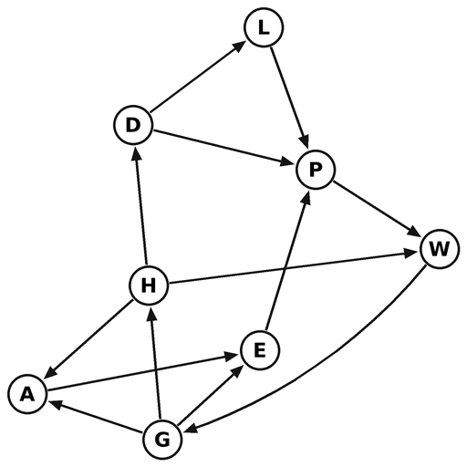
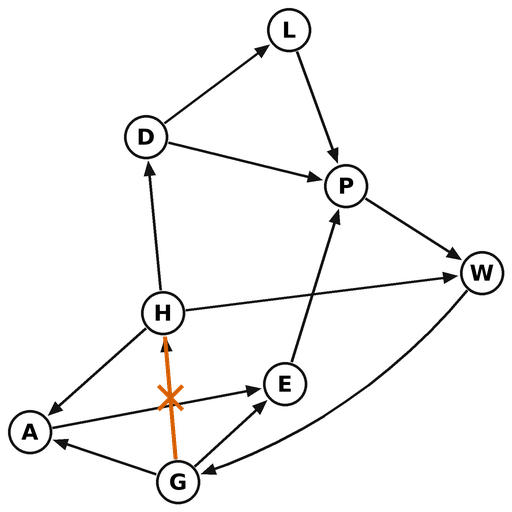
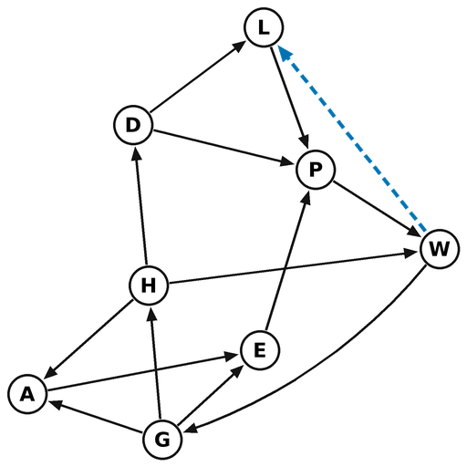
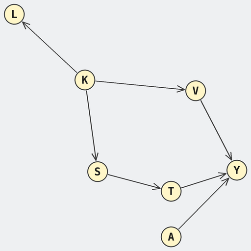
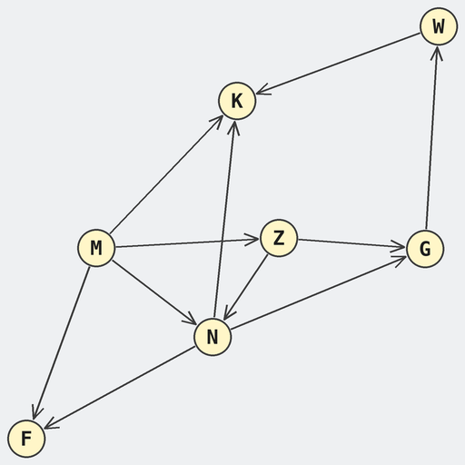
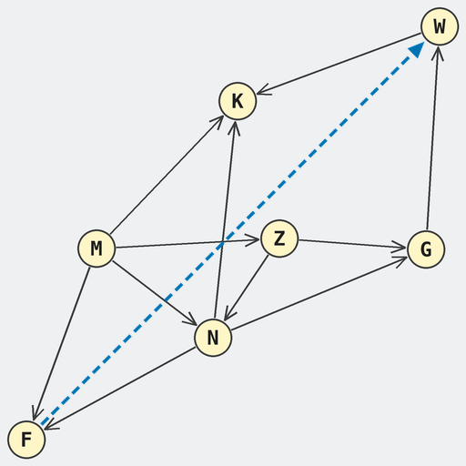

# Dev gallery: recorded responses, scored by the verifier

Generated by `scripts/dev_gallery.py`; do not edit. Every response below is a recorded model output from the
predictions file named in the table of sources; the verdict is `metrics.score_sample` against the generator's
true graph. Rule `gallery-v1` (see the script's docstring): samples in a hash order that uses no score; only the slots
named "first sample the focus arm answers ..." look at an outcome, and only at arm D's. Pool: 120 samples on 20 dev
root graphs (those with a recorded response from every arm). This is an illustration, not a measurement: the
accuracies are in `results_dev.md`. Style-change pairs are absent because no dev response was recorded for them.
Arm E's answer is computed by the exact solver from the graph its parser read from the image, so it is only as
right as that reading; the last column says how far the reading is from the true graph.

| Arm | Predictions file | sha256 (first 16) | Same file as the reported flags |
|---|---|---|---|
| A | `runs/kaggle/jobA1/runs/base_prompt_system/predictions_dev.jsonl` | `4b4104d2cff0bb1d` | yes |
| B | `runs/kaggle/job11/runs/pilot3_B/predictions_dev.jsonl` | `7d20fdbf47438cb3` | yes |
| C | `runs/kaggle/job12/runs/pilot3_C/predictions_dev.jsonl` | `db25314da4b03a82` | yes |
| D | `runs/kaggle/job20/runs/pilot3_D/predictions_dev.jsonl` | `3118d615803beedc` | yes |
| E | `runs/kaggle/job13/runs/pilot3_E/predictions_dev.jsonl` | `f15d05cbf698d307` | yes |

## Reachability, first sample the focus arm answers correctly



Sample `s4151dbdec0b8fa37`, image `images/dev/imge4a0b6fb477d44a8.png`.

```
Look at the directed graph in the image. Arrows show edge directions.
Following the arrow directions along one or more edges, is there a path from node M to node N?
Answer {"answer": true} or {"answer": false}. Answer with a single JSON object and nothing else.
```

True answer (from the generator's graph): `{"answer":false}`

| Arm | Recorded response | Verifier |
|---|---|---|
| A | `{"answer": false}` | correct |
| B | `{"answer":false}` | correct |
| C | `{"answer":false}` | correct |
| D | `{"answer": false}` | correct |
| E | `{"answer":false}` | correct; computed from the graph its parser read: 2 true edges missed, 3 invented |


## Reachability, first sample the focus arm answers wrongly



Sample `s29a4802b02ae2e68`, image `images/dev/img9d6bb373b63ee675.png`.

```
Look at the directed graph in the image. Arrows show edge directions.
Following the arrow directions along one or more edges, is there a path from node K to node W?
Answer {"answer": true} or {"answer": false}. Answer with a single JSON object and nothing else.
```

True answer (from the generator's graph): `{"answer":false}`

| Arm | Recorded response | Verifier |
|---|---|---|
| A | `{"answer": true}` | wrong (answer differs from the true graph's) |
| B | `{"answer":true}` | wrong (answer differs from the true graph's) |
| C | `{"answer":true}` | wrong (answer differs from the true graph's) |
| D | `{"answer": true}` | wrong (answer differs from the true graph's) |
| E | `{"answer":false}` | correct; computed from the graph its parser read: 2 true edges missed, 3 invented |


## Critical edge: one question on two images that differ by one edge (chosen without looking at any response)

**Base image**



Sample `s91671137aac39e97`, image `images/dev/imgd1fde63e8d93fda4.png`.

```
Look at the directed graph in the image. Arrows show edge directions.
Node F can currently reach node H by following arrows. If the edge Y->H were removed, would F no longer be able to reach H?
Answer {"answer": true} if the connection would be lost, or {"answer": false} if F could still reach H. Answer with a single JSON object and nothing else.
```

True answer (from the generator's graph): `{"answer":false}`

| Arm | Recorded response | Verifier |
|---|---|---|
| A | `{ "answer": true }` | wrong (answer differs from the true graph's) |
| B | `{"answer":false}` | correct |
| C | `{"answer":false}` | correct |
| D | `{"answer": true}` | wrong (answer differs from the true graph's) |
| E | `{"answer":false}` | correct; computed from the graph its parser read: 0 true edges missed, 0 invented |

**Twin image (one edge different, same question)**



Sample `sc7b77805d94f4891`, image `images/dev/imge03dd15cc1cac545.png`.

```
Look at the directed graph in the image. Arrows show edge directions.
Node F can currently reach node H by following arrows. If the edge Y->H were removed, would F no longer be able to reach H?
Answer {"answer": true} if the connection would be lost, or {"answer": false} if F could still reach H. Answer with a single JSON object and nothing else.
```

True answer (from the generator's graph): `{"answer":true}`

| Arm | Recorded response | Verifier |
|---|---|---|
| A | `{ "answer": true }` | correct |
| B | `{"answer":false}` | wrong (answer differs from the true graph's) |
| C | `{"answer":false}` | wrong (answer differs from the true graph's) |
| D | `{"answer": true}` | correct |
| E | `{"answer":true}` | correct; computed from the graph its parser read: 0 true edges missed, 0 invented |


## Minimal repair where one edit is needed (chosen without looking at any response)



Sample `s869fc066847a37de`, image `images/dev/imgfda441d622a16270.png`.

```
Look at the directed graph in the image. Arrows show edge directions.
Goal (reaching means following arrows along one or more edges):
- L must be able to reach A.
- P must NOT be able to reach D.
You may change at most 1 edge. Edges you are allowed to add: E->D, H->E, H->L, W->L. You may remove any edge that exists in the image.
If the goal already holds, answer {"status":"unchanged","edits":[]}.
If no single allowed change achieves the goal, answer {"status":"impossible","edits":[]}.
Otherwise answer {"status":"edited","edits":[{"op":"add_edge","src":"<node>","dst":"<node>"}]} using "op":"add_edge" or "op":"remove_edge".
Answer with a single JSON object and nothing else.
```

True answer (from the generator's graph): `{"status":"edited","edits":[{"op":"remove_edge","src":"G","dst":"H"}]}`

| Arm | Recorded response | Verifier |
|---|---|---|
| A | `{ "status":"edited", "edits":[ {"op":"remove_edge","src":"H->W"} ] }` | wrong (format failure: bad_edit) |
| B | `{"status":"impossible","edits":[]}` | wrong (status differs from the true one) |
| C | `{"status":"impossible","edits":[]}` | wrong (status differs from the true one) |
| D | `{"status":"edited","edits":[{"op":"add_edge","src":"W","dst":"L"}]}` | wrong (constraints_not_satisfied); legal=True, goal met=False, minimal=False |
| E | `{"status":"edited","edits":[{"op":"remove_edge","src":"G","dst":"H"}]}` | correct; legal=True, goal met=True, minimal=True; computed from the graph its parser read: 1 true edges missed, 0 invented |

Edits named above, marked on the image (blue dashed arrow = edge to add, orange with a cross = edge to remove;
the colour says the operation, not whether the edit is right; an added arrow is a straight marker, not a
laid-out edge). `reference` is the generator's stored answer; when several minimal edits exist it is one of them.

- remove `G->H`, named by reference, E:

  

- add `W->L`, named by D:

  


## Minimal repair where no allowed single edit works (chosen without looking at any response)



Sample `sa0a18973a19b3ff2`, image `images/dev/imgebed56a2d005100b.png`.

```
Look at the directed graph in the image. Arrows show edge directions.
Goal (reaching means following arrows along one or more edges):
- S must be able to reach A.
- S must be able to reach Y.
- K must NOT be able to reach T.
You may change at most 1 edge. Edges you are allowed to add: L->A, L->S, S->L, T->A. You may remove any edge that exists in the image.
If the goal already holds, answer {"status":"unchanged","edits":[]}.
If no single allowed change achieves the goal, answer {"status":"impossible","edits":[]}.
Otherwise answer {"status":"edited","edits":[{"op":"add_edge","src":"<node>","dst":"<node>"}]} using "op":"add_edge" or "op":"remove_edge".
Answer with a single JSON object and nothing else.
```

True answer (from the generator's graph): `{"status":"impossible","edits":[]}`

| Arm | Recorded response | Verifier |
|---|---|---|
| A | `{ "status": "edited", "edits": [ { "op": "remove_edge", "src": "K", "dst": "T" } ] }` | wrong (edge_not_present); legal=False |
| B | `{"status":"impossible","edits":[]}` | correct |
| C | `{"status":"impossible","edits":[]}` | correct |
| D | `{"status":"impossible","edits":[]}` | correct |
| E | `{"status":"impossible","edits":[]}` | correct; computed from the graph its parser read: 0 true edges missed, 0 invented |

Edits named above, marked on the image (blue dashed arrow = edge to add, orange with a cross = edge to remove;
the colour says the operation, not whether the edit is right; an added arrow is a straight marker, not a
laid-out edge). `reference` is the generator's stored answer; when several minimal edits exist it is one of them.

- remove `K->T`, named by A: not drawn (that edge is not in the image).


## Minimal repair, first sample the focus arm gets wrong



Sample `sc0eac5b0ded64974`, image `images/dev/img390b56b7299c66f1.png`.

```
Look at the directed graph in the image. Arrows show edge directions.
Goal (reaching means following arrows along one or more edges):
- F must be able to reach W.
- G must NOT be able to reach F.
You may change at most 1 edge. Edges you are allowed to add: F->W, G->F, Z->W. You may remove any edge that exists in the image.
If the goal already holds, answer {"status":"unchanged","edits":[]}.
If no single allowed change achieves the goal, answer {"status":"impossible","edits":[]}.
Otherwise answer {"status":"edited","edits":[{"op":"add_edge","src":"<node>","dst":"<node>"}]} using "op":"add_edge" or "op":"remove_edge".
Answer with a single JSON object and nothing else.
```

True answer (from the generator's graph): `{"status":"edited","edits":[{"op":"add_edge","src":"F","dst":"W"}]}`

| Arm | Recorded response | Verifier |
|---|---|---|
| A | `{ "status": "edited", "edits": [ { "op": "remove_edge", "src": "G", "dst": "F" } ] }` | wrong (edge_not_present); legal=False |
| B | `{"status":"impossible","edits":[]}` | wrong (status differs from the true one) |
| C | `{"status":"impossible","edits":[]}` | wrong (status differs from the true one) |
| D | `{"status":"impossible","edits":[]}` | wrong (status differs from the true one) |
| E | `{"status":"impossible","edits":[]}` | wrong (status differs from the true one); computed from the graph its parser read: 1 true edges missed, 3 invented |

Edits named above, marked on the image (blue dashed arrow = edge to add, orange with a cross = edge to remove;
the colour says the operation, not whether the edit is right; an added arrow is a straight marker, not a
laid-out edge). `reference` is the generator's stored answer; when several minimal edits exist it is one of them.

- add `F->W`, named by reference:

  

- remove `G->F`, named by A: not drawn (that edge is not in the image).
